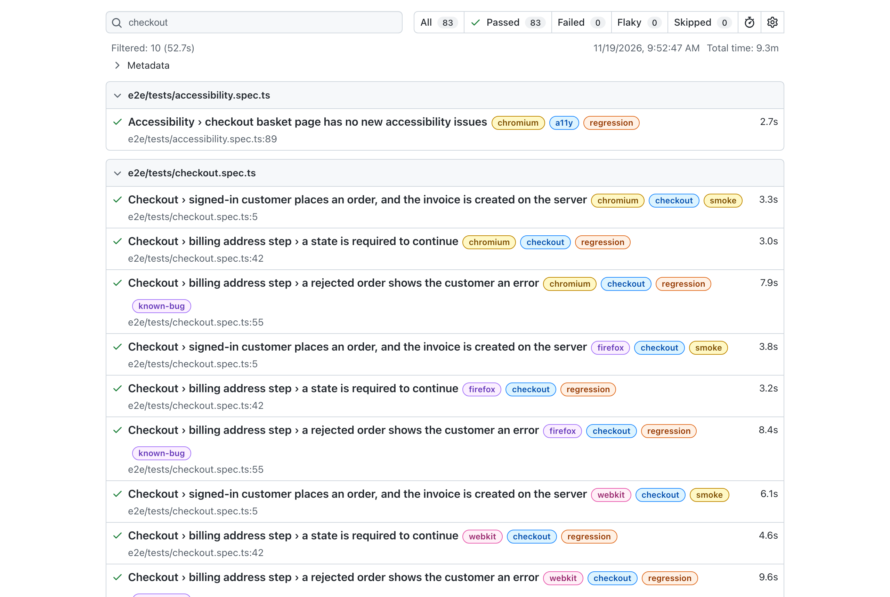

# Playwright Test Automation Framework

[](https://github.com/nishajuss/playwright-framework/actions/workflows/ci.yml)
[](https://nishajuss.github.io/playwright-framework/)

A test automation framework built with **Playwright** and **TypeScript** for [Practice Software Testing](https://practicesoftwaretesting.com), a demo tool shop with both a website and a REST API. It covers:

- **UI tests** in Chromium, Firefox and WebKit
- **API tests** with response contract validation
- **Combined UI + API tests** that use the API to set up data and to verify what the website did
- **Accessibility tests** against WCAG 2.2 AA with [axe-core](https://github.com/dequelabs/axe-core)

**[View the latest test report →](https://nishajuss.github.io/playwright-framework/)**

[](https://nishajuss.github.io/playwright-framework/)

> **See also:** [cypress-framework](https://github.com/nishajuss/cypress-framework), my BDD framework built with Cypress, Cucumber and TypeScript.

## What's covered

**UI**: 18 tests × 3 browsers

| Area | Tests |
| --- | --- |
| [Authentication](e2e/tests/auth.spec.ts) | Log in, wrong password, register on the website (verified via the API), sign out |
| [Catalogue](e2e/tests/catalogue.spec.ts) | Search, all four sort orders, category filter and product details, each checked against the API |
| [Cart](e2e/tests/cart.spec.ts) | Add with a quantity, a basket built via the API, quantity changes saved on the server, remove |
| [Checkout](e2e/tests/checkout.spec.ts) | Full order with the invoice verified via the API, address validation, a known bug |

**API**: 22 tests

| Area | Tests |
| --- | --- |
| [Auth](api/tests/auth.spec.ts) | Register, validation errors, duplicate email (409), login, token access, 401s |
| [Products](api/tests/products.spec.ts) | Pagination, get by ID, 404, search, sorting, price/brand/category filters |
| [Carts](api/tests/carts.spec.ts) | Add items, change quantity, remove, validation errors, delete |

**Accessibility**: 7 tests

| Area | Tests |
| --- | --- |
| [Accessibility](e2e/tests/accessibility.spec.ts) | axe scans of six key pages against a known-issue baseline; keyboard-only login |

Everything runs on every push, on pull requests and nightly. CI runs against a private copy of the shop started in Docker (see [Test environments](#test-environments)).

## Design decisions

- **The API sets up, the UI tests, the API verifies.** UI tests use the API for anything that isn't the behaviour under test. Accounts are registered and logged in through the API, and baskets are created through the API and handed to the browser. Results are then checked on the server: for example, the [checkout test](e2e/tests/checkout.spec.ts) places an order on the website, then confirms the API has a matching invoice with the right total and items. This makes tests faster and more reliable, and proves the website really did what it showed.
- **Fresh accounts, no shared state.** The site's public demo logins can be changed by anyone, so each test worker [registers its own customer](api/fixtures.ts). Each test logs in through the API, because tokens only last five minutes.
- **Signed in by default, without the login form.** The login token is placed in the browser's storage before the page loads, the same place the site keeps it, so tests start signed in. The login form has its own dedicated tests.
- **Page objects and API clients as fixtures.** [Page objects](e2e/pages) and [API clients](api/clients.ts) are injected through Playwright fixtures. The [UI fixtures](e2e/fixtures.ts) build on the [API fixtures](api/fixtures.ts), so every UI test can use the API too.
- **Contract validation.** Every API response is parsed against a [zod schema](api/schemas.ts), so a missing field or wrong type fails a test even when that test doesn't check the field directly. This caught a real inconsistency: search results leave out a field the main product list includes.
- **Expectations from data, not hard-coded.** Products, prices and sort orders come from the API at runtime, so tests survive catalogue changes.
- **Web-first assertions, no hard waits.** Assertions retry until the UI settles. Where the site has a genuine race (see below), the test waits for that specific condition and explains why.
- **Accessibility baseline.** The site already has accessibility issues. Rather than switching rules off site-wide, each page [lists its known issues](e2e/tests/accessibility.spec.ts), and a scan fails on any new one. Known issues are noted on every run, and the full scan results are attached to the report.
- **CI owns its test environment.** CI starts its own copy of the shop from the project's published Docker images and loads fresh demo data for every run. Tests don't depend on a shared public server being up, and they leave nothing behind on it.
- **Known bugs are tests too.** A confirmed bug gets a test marked as expected to fail. It passes while the bug exists, and Playwright reports it as soon as the bug is fixed, as a prompt to update the test.

## Bugs found

Writing these tests uncovered real defects in the site:

1. **Checkout overwrites the customer's saved address.** When the billing address step opens, a postcode lookup replaces the saved street and city with made-up values. For UK addresses it also clears the required state field, which blocks checkout. It's a race between two background requests, so it happens intermittently. The tests use US customers to avoid it, and [`checkoutPage.ts`](e2e/pages/checkoutPage.ts) explains the workaround.
2. **A rejected order fails silently.** If the server rejects an order, the page stays on "Confirm" with no error message. Documented by an expected-to-fail test in [`checkout.spec.ts`](e2e/tests/checkout.spec.ts) that simulates the rejection with network mocking.
3. **Accessibility failures**, including buttons with no accessible name, invalid list markup, and touch targets that are too small. Listed per page in [`accessibility.spec.ts`](e2e/tests/accessibility.spec.ts).
4. **Inconsistent API contract.** Product search results omit the category `slug` that the product list includes.

## Tech stack

Playwright · TypeScript (strict) · axe-core · zod · Docker · ESLint (typescript-eslint + eslint-plugin-playwright) · GitHub Actions · GitHub Pages · Dependabot

## Project structure

```
api/                   # API layer, shared by the API and UI tests
├── tests/             # API test specs
├── clients.ts         # API clients (the API equivalent of page objects)
├── schemas.ts         # Response contracts (zod)
├── testData.ts        # Builds unique test customers
└── fixtures.ts        # API clients, per-worker customer and login token
e2e/                   # UI and accessibility tests
├── tests/             # UI test specs
├── pages/             # Page objects
│   └── components/    # Shared UI components (header)
└── fixtures.ts        # Page objects, API-seeded baskets, signed-in state, axe
shop/                  # Docker setup for a private copy of the shop (used by CI)
scripts/
└── writeJobSummary.mts # Test results summary shown on each CI run page
.github/
├── workflows/ci.yml   # Lint, typecheck, test matrix (API + 3 browsers), merged report publishing
└── dependabot.yml     # Weekly dependency and GitHub Actions updates
```

## Getting started

Prerequisites: Node.js 24 (see [`.nvmrc`](.nvmrc)) and Yarn 1. No credentials needed: tests create their own accounts.

```bash
nvm use
yarn install
npx playwright install --with-deps
yarn test
```

## Test environments

| Environment | When | How |
| --- | --- | --- |
| Live site ([practicesoftwaretesting.com](https://practicesoftwaretesting.com)) | Default for local runs | `yarn test` |
| Private copy in Docker | CI, or locally with Docker installed | `yarn shop:up`, then `yarn test:local` (`yarn shop:down` to stop) |

CI can't use the live site: its bot protection (Cloudflare) blocks requests from CI servers with a "verify you are human" check. Rather than trying to get around that, CI starts the shop from the project's [published Docker images](https://github.com/testsmith-io/practice-software-testing) (pinned to version 2.5) with fresh demo data. The URLs are set by `BASE_URL` and `API_BASE_URL` (see [`.env.template`](.env.template)).

## Commands

| Command | Description |
| --- | --- |
| `yarn test` | Run everything: API tests and UI tests in all browsers |
| `yarn test:chromium` | Run UI and accessibility tests in Chromium only |
| `yarn test:api` | Run the API tests |
| `yarn test:a11y` | Run the accessibility tests |
| `yarn shop:up` / `yarn shop:down` | Start or stop a local copy of the shop in Docker |
| `yarn test:local` | Run everything against the local copy |
| `yarn test:smoke` | Run only `@smoke` tests |
| `yarn test:grep "@checkout"` | Run tests matching a tag or name |
| `yarn test:headed` | Run in a visible browser (Chromium) |
| `yarn test:ui` | Open Playwright UI mode for debugging |
| `yarn report` | Open the HTML report from the last run |
| `yarn validate` | Lint and typecheck |

## Reports and debugging

The Playwright HTML report (`playwright-report/`) includes screenshots, video and a full trace for any failed test, with every network request. Open a trace with `npx playwright show-trace <trace.zip>`.

In CI, the API and browser jobs run in parallel, and their results are merged into a single HTML report. That report is uploaded as a build artifact, and the latest `main` run is published to [GitHub Pages](https://nishajuss.github.io/playwright-framework/).

## Adding a test

1. Add a test to the matching file in `e2e/tests/` (UI) or `api/tests/` (API), or create a new `*.spec.ts` file. Import `test` and `expect` from that folder's `fixtures.ts`.
2. Put selectors and page interactions in a page object, or API calls in a client, and expose new ones as fixtures. Add a zod schema for any new API response.
3. Prefer the API for test setup and for verifying results. Use the UI for the behaviour being tested.
4. Tag the test (`@smoke` or `@regression`, plus its area).
5. Run `yarn test:chromium` (or `yarn test:api`) and `yarn validate`.
